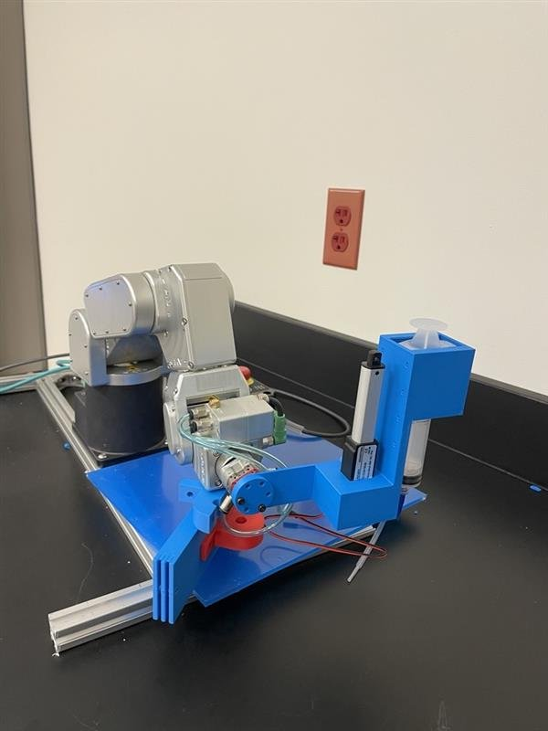
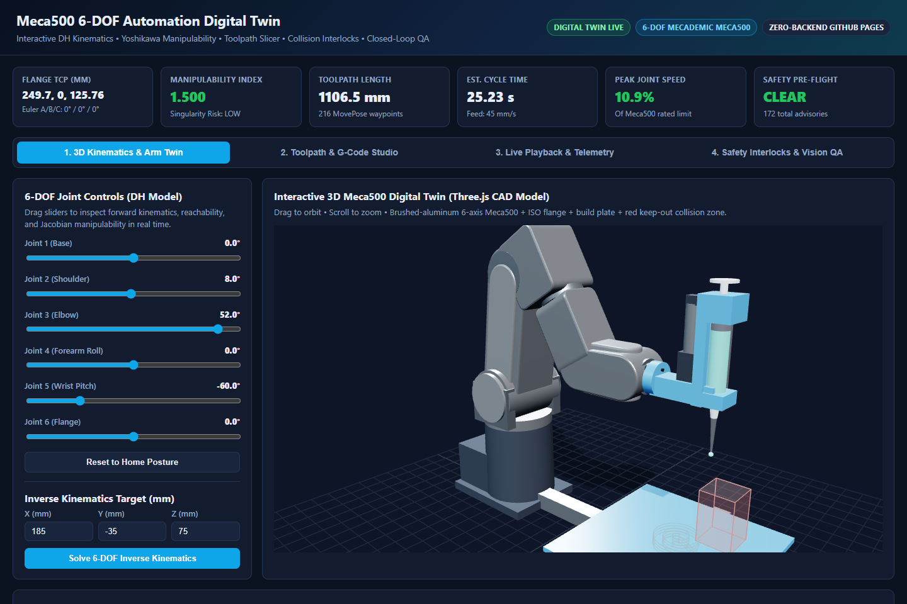
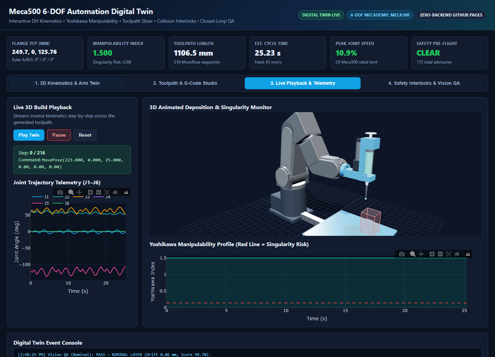

# MECA 500 Master Control & 6-DOF Automation Digital Twin

**Live Interactive Digital Twin (GitHub Pages):** [https://abishekkafle.github.io/Meca500-Master-Control/](https://abishekkafle.github.io/Meca500-Master-Control/)

An integrated robotics & automation digital twin platform for the **Mecademic Meca500 (Six-Axis Industrial Robot)**, combining 6-DOF Denavit-Hartenberg Kinematics, **Jacobian / Yoshikawa Manipulability & Singularity Monitoring**, **Virtual Keep-Out Fixture Collision Interlocks**, **Joint-Velocity & Cycle-Time Telemetry**, Parametric & Infill Toolpath Planning, 3D Mesh Point-Cloud Scanning, G-code Conversion, Real-Time TCP Execution/Simulation, and Vision Defect Inspection.

---

## Physical Lab Hardware vs. 3D Digital Twin

| Real Meca500 DIW Hardware Setup | Interactive Three.js 3D Digital Twin |
| :---: | :---: |
|  |  |

### Live Joint Trajectories (J1–J6) & Yoshikawa Manipulability Telemetry


---

## 🌐 Instant Live Digital Twin (No Installation Needed)

Open `index.html` locally or visit **GitHub Pages** (`https://abishekkafle.github.io/Meca500-Master-Control/`) to interact directly in the browser:
- **3D 6-DOF Arm Twin & Kinematics:** Real-time DH Forward & Inverse Kinematics with reachability and joint-limit validation.
- **Singularity & Manipulability Monitor:** Computes numerical positional Jacobian $J$ and Yoshikawa manipulability $\sqrt{\det(JJ^T)}$ across the entire toolpath.
- **Safety Pre-Flight & Collision Interlocks:** Configurable 3D keep-out fixture bounding box, floor Z-collision check, and peak joint-speed (% of Meca500 rated limits) audit.
- **Toolpath Slicer & MecaScript Export:** Shapes (Spiral, Rectangle, Cylinder, Mesh Grid), Additive Infills (Rectilinear, Concentric, Grid, Honeycomb), and G-Code → `MovePose(...)` export.
- **Closed-Loop Vision QA Simulator:** Mirrors the backend CLAHE + 6-state Kalman `PrecisionTracker` interlock logic.

---

## 📁 Repository Structure

```text
Meca500-Master-Control/
├── index.html                      # Zero-backend 3D Digital Twin (GitHub Pages entry)
├── web/
│   ├── styles.css                  # Industrial dark-slate telemetry UI
│   ├── meca_twin.js                # 6-DOF DH Kinematics, Jacobian, Collision & Audit Engine
│   └── app.js                      # Interactive 3D Plotly Twin & Playback Controller
├── backend/
│   ├── server.py                   # FastAPI REST Server, TCP Port 10000 & OpenCV/Open3D Engine
│   └── requirements.txt            # Backend Python Dependencies
├── frontend/                       # React Full-Stack Control Dashboard
├── tests/
│   └── test_kinematics_twin.py     # Pytest verification suite for kinematics & toolpaths
├── sample_models/
│   └── sample_cube.stl             # Sample 3D Model for Slicing & Surface Scanning
└── run_app.bat                     # One-Click Windows Full-Stack Launcher
```

---

## 🛠️ Prerequisites

Ensure the following tools are installed on your system before running:

- **Python**: `v3.9` or higher ([python.org](https://www.python.org/))
- **Node.js**: `v16.0` or higher ([nodejs.org](https://nodejs.org/))
- **npm**: Included with Node.js (`v8.0+`)

---

## 🚀 Quick Start Instructions

### Option 1: One-Click Launch (Windows)

Simply double-click **`run_app.bat`**. This script will:
1. Install Python backend dependencies.
2. Launch the FastAPI server at `http://localhost:8000`.
3. Install Node.js packages and launch the React dashboard at `http://localhost:3000`.

---

### Option 2: Manual Terminal Setup

#### Step 1: Start Python Backend Server
```bash
cd backend
pip install -r requirements.txt
python server.py
```
*The backend API will be live at `http://127.0.0.1:8000` with interactive Swagger API docs at `http://127.0.0.1:8000/docs`.*

#### Step 2: Start React Frontend Dashboard
Open a new terminal window:
```bash
cd frontend
npm install
npm start
```
*The web application will automatically open in your browser at `http://localhost:3000`.*

---

## ⚡ Key Architecture & Features

### 1. Multi-Algorithm Kinematics Engine
- **Numerical Denavit-Hartenberg (DH)**: Standard forward & inverse kinematics transformation matrices.
- **SymPy Analytical Solver**: Closed-form geometric inverse kinematics derivation.
- **Geometric Arm Solver**: Direct trigonometric upper arm and forearm link solver.

### 2. Path Planning & Infill Slicing Suite
- **Parametric Shapes**: Rectangle, Cylinder, Mesh Grid, and Spiral toolpaths.
- **Advanced Infill Patterns**: Rectilinear, Concentric, Grid, Triangles, and Honeycomb slicing with configurable density percentage (0–100%).
- **3D Surface Point-Cloud Scanner**: Surface sampling via Open3D / Trimesh with optional high-resolution **Cubic Spline Path Smoothing**.
- **G-Code Parser & MECA 500 Converter**: Direct conversion of standard G-code `G1` commands into Meca500 native `MovePose(x, y, z, a, b, c)` commands.

### 3. Real Robot TCP & Simulation Controller
- Socket connection over TCP (`Port 10000`) for direct execution on physical Meca500 hardware.
- Safe simulation fallback mode when disconnected.
- Step-by-step progress tracking, speed adjustment slider, and MECA script `.txt` exporter.

### 4. Vision Defect Inspection
- Computer vision pipeline using **Contrast Limited Adaptive Histogram Equalization (CLAHE)**, Hough Circle Transforms, and a 6-state **Kalman Filter (`PrecisionTracker`)** for real-time feature tracking and layer quality grading.

---

## 🔌 API Endpoint Documentation

| Endpoint | Method | Description |
| :--- | :--- | :--- |
| `GET /` | `GET` | API Health Check |
| `/api/kinematics/forward` | `POST` | Calculate end-effector position & posture from joint angles (`J1`..`J6`) |
| `/api/kinematics/inverse` | `POST` | Calculate joint angles using chosen solver (`dh`, `analytical`, `geometric`) |
| `/api/path/generate` | `POST` | Generate parametric shape or infill toolpath waypoints and MECA commands |
| `/api/path/pointcloud_scan` | `POST` | Extract surface point cloud from STL/OBJ with optional CubicSpline smoothing |
| `/api/slicer/stl_to_gcode` | `POST` | Slice 3D mesh into standard G-code lines |
| `/api/slicer/gcode_to_meca` | `POST` | Convert raw G-code text to MECA 500 `MovePose` commands |
| `/api/vision/inspect` | `POST` | Analyze layer snapshot image for defects & return Kalman tracker metrics |
| `/api/robot/connect` | `POST` | Connect to physical Meca500 IP address via TCP socket |
| `/api/robot/command` | `POST` | Send single raw ASCII command (`ActivateRobot`, `Home`, `ResetError`, etc.) |

---

## 🎓 Academic Reference & Future Scope

This project consolidates research code developed for MECA 500 robotic 3D printing and trajectory control. Future expansions include:
- Multi-robot synchronized collision detection.
- Real-time closed-loop visual servoing during active printing.
